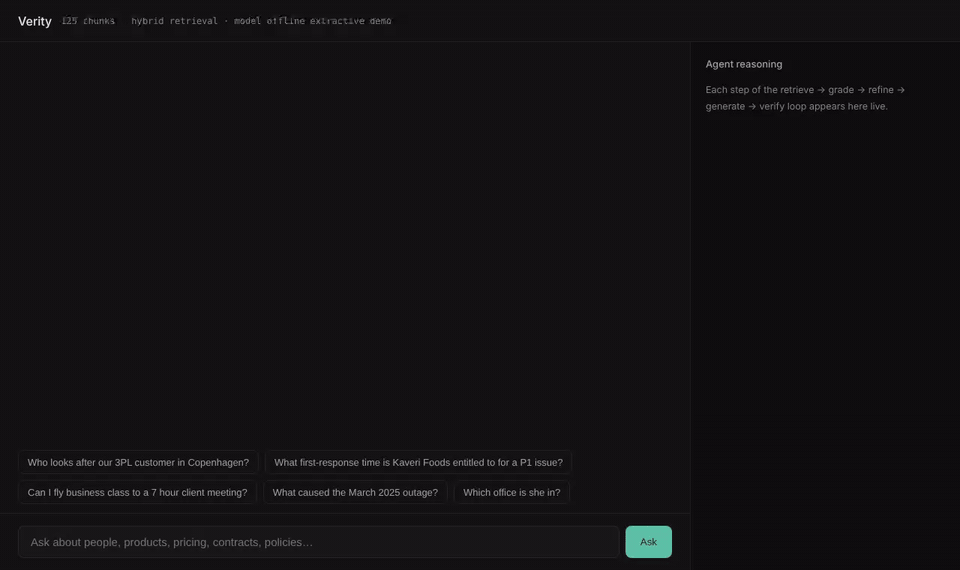
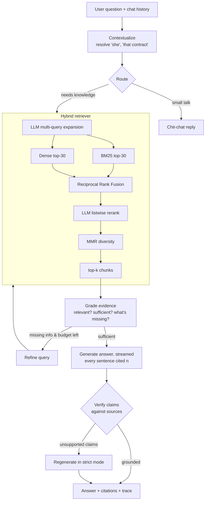

<div align="center">

# Verity

**A self-verifying agentic RAG engine.**
Ask a question about a company's knowledge base. Verity plans its searches, checks whether the evidence it found is enough, searches again when something is missing, and fact-checks its own answer before returning it, with a citation on every sentence.

   

</div>



## Why I built this

Most RAG demos embed the documents, take the top-k chunks and stuff them into a prompt. That breaks down on the questions people actually ask at work:

- **Indirect questions.** "Who looks after our 3PL customer in Copenhagen?" never names the client.
- **Multi-hop questions.** "Which office does the person who runs the cold-chain product work from?" needs two documents.
- **Exact numbers.** Prices, SLAs and contract values, where embeddings blur `2,400` and `1,800` together.
- **Hallucinated confidence.** The model answers fluently even when retrieval missed.

Verity treats retrieval as a loop to get right, and measures every design choice with an evaluation harness instead of guessing.

## Highlights

- **Hybrid retrieval.** BM25 (written from scratch) and dense vectors are fused with Reciprocal Rank Fusion. On top of that: LLM multi-query expansion, LLM listwise reranking and MMR diversification.
- **Corrective agent loop (CRAG-style).** The agent grades its retrieved evidence. If something is missing it writes a targeted follow-up query and searches again.
- **Self-verification.** A fact-checking pass looks for unsupported claims and regenerates the answer in strict mode if it finds any.
- **Evaluation harness.** 185 golden questions in 8 categories, scored with MRR, nDCG@k, Recall@k and keyword coverage, plus an LLM-as-judge for accuracy, completeness and relevance. It runs an ablation table and a retrieval-quality gate in CI.
- **Observability.** Every request produces a span tree with latency, token counts and cost per step, available at `/api/traces/{id}`.
- **Production shape.** FastAPI with Server-Sent Events streaming, a live "agent reasoning" UI, Docker, a CI matrix, and support for any OpenAI-compatible provider (OpenAI, Groq, OpenRouter, or local Ollama).

---

## Architecture



The agent is an **explicit state machine** in [`agent/agent.py`](src/verity/agent/agent.py) rather than a framework graph, so every transition is visible and unit-tested. Each node emits a streaming event, and the UI renders them live in the side panel.

## Evaluation

The knowledge base is a synthetic company, Helix Freight: 43 documents covering employees, products and pricing, customer contracts, HR, expense and security policies, an incident postmortem and an architecture document. `scripts/build_corpus.py` generates the corpus **and** the golden set from the same structured records, so reference answers can never drift from the documents.

The golden set has 185 questions across 8 categories: `direct_fact`, `numerical`, `relationship`, `holistic`, `temporal`, `spanning`, `paraphrase` and `multi_hop`. The last two are deliberately indirect. For example, *"Who looks after our 3PL customer in Copenhagen?"* never names the client.

### Retrieval ablation, offline (`verity eval`, k = 5, no API key needed)

**Hard subset: paraphrased and multi-hop questions (n = 66)**

| Configuration | MRR | nDCG@5 | Recall@5 | Keyword cov. |
|---|---|---|---|---|
| BM25 · fixed chunks | 0.985 | 0.969 | 0.977 | 0.985 |
| Dense (LSA) · fixed chunks | 0.891 | 0.904 | 0.985 | 0.992 |
| Hybrid RRF · fixed chunks | 0.977 | 0.968 | 0.985 | 0.992 |
| BM25 · markdown + context headers | 0.992 | 0.971 | 0.985 | 0.924 |
| Dense (LSA) · markdown + context headers | 0.904 | 0.900 | 0.977 | 0.894 |
| **Hybrid RRF · markdown + context headers** | **1.000** | **0.979** | **0.985** | 0.939 |
| Hybrid RRF · markdown · + MMR | 1.000 | 0.973 | 0.970 | 0.932 |

**All questions (n = 185), best configuration, by category**

| Category | n | MRR | nDCG@5 | Recall@5 |
|---|---|---|---|---|
| direct_fact | 71 | 1.000 | 1.000 | 1.000 |
| paraphrase | 53 | 1.000 | 1.000 | 1.000 |
| numerical | 21 | 0.827 | 0.870 | 1.000 |
| relationship | 16 | 1.000 | 0.975 | 1.000 |
| multi_hop | 13 | 1.000 | 0.865 | 0.846 |
| holistic | 7 | 1.000 | 0.656 | **0.552** |

**What the numbers say**

- **Dense-only retrieval is the weakest on indirect questions** (MRR 0.89). Fusing it with BM25 recovers the exact names, numbers and IDs that embeddings blur, and lifts MRR to 1.00.
- **Contextual chunk headers** ("Contract: Kaveri Foods > Summary" prepended to each chunk) make small chunks self-describing. They cost some keyword coverage because the chunks are smaller. That tradeoff is visible in the table rather than hidden.
- **Single-shot retrieval falls short on aggregation and numbers.** Holistic questions ("which clients use DockSense?") only reach 55% recall at k = 5. Numerical questions ("what does the RouteIQ Growth tier cost?") rank contracts that *mention* RouteIQ Growth above the pricing page. These are the failure modes that query decomposition, LLM reranking and the corrective grade → refine loop target.
- Run `make eval-llm` to add the LLM-expansion and rerank rows and the LLM-as-judge answer scores (accuracy, completeness, relevance, groundedness rate, tokens and cost per answer) for your model of choice. Results are written to `evals/results/`.

CI fails the build if the best hard-set MRR drops below 0.95.

## Quick start

```bash
pip install -e ".[dev]"
cp .env.example .env            # set VERITY_LLM_API_KEY (or point VERITY_LLM_BASE_URL at Groq / OpenRouter / Ollama)

verity ingest                       # chunk + embed + index  (offline)
verity eval                         # retrieval ablation     (offline)
verity ask "Who looks after our 3PL customer in Copenhagen, and which office are they in?" -v
verity chat                         # multi-turn, follow-ups like "which office is she in?" work
verity serve                        # http://localhost:8000  (chat UI with live agent reasoning)
verity serve --demo                 # same UI with no API key: an offline extractive model quotes the sources
```

**Fully local, with no API key:** `docker compose --profile local up --build`, then `docker compose exec ollama ollama pull llama3.1:8b`.

**Bring your own documents:** point `VERITY_KB_DIR` at a folder of `.md`, `.txt` or `.pdf` files and run `verity ingest`.

### API

| Method | Path | Description |
|---|---|---|
| `POST` | `/api/ask` | `{question, history}` → answer, citations, steps, usage, latency |
| `POST` | `/api/ask/stream` | SSE events: `step` · `token` · `revision` · `final` |
| `GET` | `/api/traces` · `/api/traces/{id}` | recent requests, or the full span tree for one request |
| `POST` | `/api/reindex` | rebuild the index from the knowledge-base folder |

## Design decisions

| Decision | Why |
|---|---|
| **BM25 written from scratch** | About 60 lines. The tokenizer keeps `78,000` and `99.9` intact, because exact figures are where lexical search beats embeddings. |
| **RRF instead of weighted score blending** | BM25 scores and cosine similarities sit on incomparable scales. RRF only uses ranks, so nothing needs calibrating. |
| **LSA embeddings as the offline default** | TF-IDF (word and char n-grams) plus truncated SVD: zero downloads and deterministic, so CI evaluates without network access. Switch to `VERITY_EMBED_PROVIDER=openai` for neural embeddings. |
| **Structured output via validate-and-retry** | JSON mode plus Pydantic validation, with the validation error fed back on failure. This works on providers without native JSON-schema enforcement, including small Ollama models. |
| **Graceful degradation** | If expansion, rerank, grade or verify fail, the pipeline falls back to the plain path instead of failing the request. Provider outages return a clear 502. |
| **One worker thread per streamed request** | The synchronous agent runs in a single thread that feeds an asyncio queue, so tracing context survives and the event loop never blocks. |

## Project layout

```
src/verity/
  ingest/      loaders (md/txt/pdf) · chunking (fixed / recursive / markdown + context headers)
  index/       bm25 · embeddings (LSA / OpenAI-compatible / hashing) · persisted KnowledgeIndex
  retrieval/   HybridRetriever: expansion → BM25+dense → RRF → LLM rerank → MMR
  agent/       KnowledgeAgent: contextualize → route → retrieve ⇄ grade/refine → generate → verify
  eval/        metrics (MRR, nDCG, recall, keyword coverage) · ablation runner · LLM-as-judge
  api/         FastAPI + SSE + static chat UI
  llm.py       OpenAI-compatible client, retries, cost accounting, FakeLLM for tests
  tracing.py   contextvar span tree, token/cost roll-up
scripts/build_corpus.py   synthetic corpus + golden set from one source of truth
tests/                    27 tests: chunking, BM25, fusion, MMR, metrics, agent loop branches, API, SSE
```

## Roadmap

- Cross-encoder reranker option (e.g. `bge-reranker`) to compare against LLM listwise reranking on cost and latency
- GraphRAG-style entity index for aggregation questions (the holistic category)
- Persisted conversation memory, with per-user document access control filters
